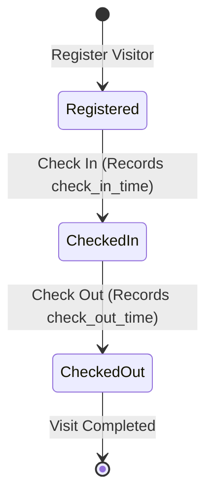

# 🏢 Visitor Management Mobile Application (Flutter)

A modern, production-grade Flutter mobile application built for front-desk and security personnel to register visitors, manage visitor information, generate and scan QR codes, track real-time check-in/check-out workflows, and view visual analytics across residential projects.

Developed using **BLoC Architecture**, **Clean Code principles**, **REST API integration with offline persistence**, and following the exact **13-screen UI wireframes**.

---

## 📱 Wireframe Screen Mapping

The application precisely implements each screen from the reference wireframe:

| Screen # | Screen Name | Functionality & Key UI Features |
|:---:|:---|:---|
| **1** | **Splash Screen** | Branding screen with person ID badge icon, app title, subtitle, and smooth loading progress bar. |
| **2** | **Login Screen** | Front-desk authentication with username, password, visibility toggle, and credential persistence. |
| **3** | **Dashboard Screen** | Date header, 3 summary statistic cards (*Total Visitors Today*, *Currently Checked In*, *Checked Out Today*), Quick Action shortcuts (*Register Visitor*, *Visitor List*, *Scan QR Code*), and navigation drawer. |
| **4** | **Register Visitor Screen** | Form with 10-digit mobile validation, optional email validation, visitor type dropdown (*Customer, Vendor, Other*), project dropdown (*Project A, Project B, Project C*), and purpose. |
| **5** | **Visitor List Screen** | Search bar (by name or mobile number), project/status filter chips, pull-to-refresh, visitor cards with status chips, and edit/delete actions. |
| **6** | **Visitor Details Screen** | Full visitor profile, contact info, timestamps, live QR code display, status actions (*Check In* / *Check Out*), and Edit shortcut. |
| **7** | **Edit Visitor Screen** | Pre-populated editing form to update visitor details with instant API/local synchronization. |
| **8** | **Delete Confirmation Dialog** | Modal dialog with warning icon and confirmation buttons (*Cancel*, *Delete*). |
| **9** | **QR Code Generation Screen** | High-resolution visitor pass QR code with Visitor ID, Download, and Share options. |
| **10** | **Scan QR Code Screen** | Camera viewfinder with corner brackets, flash toggle, camera switch, debounce protection, and manual ID entry fallback. |
| **11** | **Scanned Visitor Info Screen** | Scanned visitor card with status badge, enabled/disabled *Check In* and *Check Out* buttons enforcing workflow rules, and *View Details* action. |
| **12** | **Check-In / Check-Out Success Screen**| Success feedback screen with checkmark, confirmation text, visit summary card, and OK action button. |
| **13** | **Statistics Screen** | Weekly activity dual bar chart (*Checked In* vs *Checked Out*), Visitor Type donut distribution chart, and REST API runtime configuration. |

---

## 🏗️ Architecture & Folder Structure

The project follows the **BLoC (Business Logic Component)** pattern with clean separation of concerns:

```
lib/
├── core/
│   ├── constants/
│   │   ├── api_constants.dart      # Base URLs and timeouts
│   │   ├── app_colors.dart         # Consistent design system palette
│   │   └── app_constants.dart      # Visitor types, projects, statuses
│   ├── theme/
│   │   └── app_theme.dart          # Light theme, typography, input & button styles
│   ├── utils/
│   │   ├── date_formatter.dart     # Local date & time display utilities
│   │   └── validators.dart         # Form validation rules (10-digit mobile, email, required)
│   └── widgets/
│       ├── confirm_delete_dialog.dart # Delete warning dialog
│       ├── custom_button.dart         # Primary and outlined action buttons
│       ├── custom_dropdown.dart       # Form dropdown component
│       ├── custom_text_field.dart     # Form input field with validation
│       ├── empty_state_view.dart      # Empty state placeholder
│       ├── loading_view.dart          # Loading indicator
│       ├── stat_card.dart             # Dashboard statistic metric cards
│       ├── status_chip.dart           # Color-coded visitor status chips
│       └── visitor_card.dart          # Reusable visitor list tile card
├── data/
│   ├── datasources/
│   │   ├── visitor_local_datasource.dart   # SharedPreferences persistence & caching
│   │   └── visitor_remote_datasource.dart  # REST API HTTP client (GET, POST, PUT, PATCH, DELETE)
│   ├── models/
│   │   └── visitor_model.dart              # Visitor entity, JSON serialization, workflow helpers
│   └── repositories/
│       └── visitor_repository.dart         # Repository coordinating remote API & local cache
├── logic/
│   └── blocs/
│       ├── auth/                           # Authentication BLoC (Login, Logout, Session check)
│       │   ├── auth_bloc.dart
│       │   ├── auth_event.dart
│       │   └── auth_state.dart
│       └── visitor/                        # Visitor Management BLoC (CRUD, Search, Filter, Scan, Status)
│           ├── visitor_bloc.dart
│           ├── visitor_event.dart
│           └── visitor_state.dart
├── presentation/
│   └── screens/
│       ├── auth/
│       │   └── login_screen.dart
│       ├── dashboard/
│       │   └── dashboard_screen.dart
│       ├── main/
│       │   └── main_navigation_screen.dart # Bottom navigation orchestrator
│       ├── scanner/
│       │   ├── qr_scanner_screen.dart
│       │   └── scanned_visitor_info_screen.dart
│       ├── splash/
│       │   └── splash_screen.dart
│       ├── statistics/
│       │   └── statistics_screen.dart
│       ├── success/
│       │   └── status_success_screen.dart
│       └── visitors/
│           ├── qr_display_screen.dart
│           ├── register_visitor_screen.dart
│           ├── visitor_details_screen.dart
│           └── visitor_list_screen.dart
└── main.dart                               # Entry point, dependency injection & provider setup
```

---

## ⚙️ State Management Approach

- **`VisitorBloc`**:
  - Encapsulates all visitor operations: loading, searching, filtering, registration, editing, check-in, check-out, QR lookup, and deletion.
  - Automatically recalculates dashboard metrics (`totalVisitorsToday`, `currentlyCheckedIn`, `checkedOutToday`) reactively whenever any visitor record changes.
  - Guarantees seamless synchronization across all screens (Visitor List, Visitor Details, Dashboard, Scanner).
- **`AuthBloc`**:
  - Handles login authentication and remembers login session in `SharedPreferences`.

---

## 🔄 Visitor Status Workflow & Business Rules



### Business Rules Enforced:
1. **Registered → Checked In → Checked Out**: Strict linear workflow.
2. **No Early Check-Out**: Visitors cannot check out before checking in.
3. **No Duplicate Check-In**: Once checked in, a visitor cannot check in again.
4. **No Re-entry after Check-Out**: Completed visits cannot be checked in again.
5. **Scanner Debounce**: Scanner prevents duplicate callbacks from firing multiple times.

---

## 🌐 Mock REST API & Persistence Fallback

- **Configurable Base URL**: Can be customized in runtime via the **More / Statistics** screen or initialized with any standard MockAPI endpoint.
- **REST Endpoints Supported**:
  - `GET /visitors` — Fetch all visitors
  - `GET /visitors/{id}` — Fetch visitor details
  - `POST /visitors` — Create new visitor record
  - `PUT /visitors/{id}` — Edit visitor record
  - `PATCH /visitors/{id}` — Update check-in/check-out status & timestamps
  - `DELETE /visitors/{id}` — Delete visitor record
- **Persistent Local Caching**: Even if the remote mock API server is unreachable, rate-limited, or offline, the app seamlessly falls back to persistent storage in `SharedPreferences` with sample seed data. All CRUD changes, status updates, and newly registered visitors persist across application restarts.

### Sample Visitor JSON
```json
{
  "id": "VST001",
  "name": "Aarav Sharma",
  "mobile": "9876543210",
  "email": "aarav@gmail.com",
  "visitor_type": "Customer",
  "project": "Project A",
  "purpose": "Meeting",
  "status": "Checked In",
  "created_at": "2026-10-26T09:15:00",
  "check_in_time": "2026-10-26T09:30:00",
  "check_out_time": null
}
```

---

## 📦 Packages & Dependencies

| Package | Version | Purpose |
|:---|:---|:---|
| `flutter_bloc` | `^8.1.6` | Reactive BLoC state management |
| `equatable` | `^2.0.5` | Value equality for BLoC states & events |
| `http` | `^1.2.2` | REST API client for CRUD operations |
| `qr_flutter` | `^4.1.0` | QR Code generation |
| `mobile_scanner`| `^6.0.4` | Camera-based barcode & QR scanning |
| `intl` | `^0.19.0` | Date and time formatting |
| `shared_preferences` | `^2.3.2` | Local storage & offline data persistence |
| `uuid` | `^4.5.1` | Unique identifier utilities |

---

## 🚀 Setup & Execution Instructions

### Prerequisites
- **Flutter SDK**: 3.44.4 or later
- **Dart SDK**: 3.12.2 or later
- **Android SDK**: API 21+ (Android 5.0 Lollipop or higher)

### 1. Clone & Install Dependencies
```bash
git clone <repository-url>
cd visitor_mangement_app
flutter pub get
```

### 2. Run the App
```bash
# Run on connected Android device / emulator
flutter run

# Run on Chrome for instant web preview
flutter run -d chrome
```

### 3. Run Automated Tests
```bash
flutter test
```

### 4. Build Installable Android APK
```bash
flutter build apk --release
```
The output APK will be located at:
`build/app/outputs/flutter-apk/app-release.apk`

---

## 🧪 Automated Tests Included
- **`visitor_model_test.dart`**: Tests JSON serialization, deserialization, status getters, and business rule transitions (`canCheckIn`, `canCheckOut`).
- **`validators_test`**: Tests 10-digit numeric phone validation, optional email validation, and required text fields.
- **`widget_test.dart`**: Widget tests for `StatusChip` rendering and styling.

---

## 🔒 Known Limitations & Future Enhancements
- **Multi-visit History**: As specified in the assignment scope, one visit session per registration is implemented.
- **Biometric Integration**: Future enhancement could include fingerprint or face verification for high-security facilities.
- **Push Notifications**: Cloud messaging can be integrated to notify project hosts upon visitor arrival.
